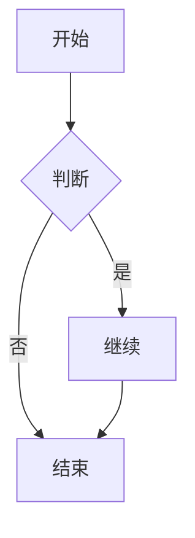

# 扩展语法样例

[TOC]

## 数学公式

行内公式 $E = mc^2$ 与块级公式：

$$
\int_0^\infty e^{-x^2} dx = \frac{\sqrt{\pi}}{2}
$$

## 代码块

```ts
const greeting: string = 'Hello'
export function greet(name: string) {
  return `${greeting}, ${name}!`
}
```

## 流程图



## 表格

| 功能 | 状态 |
| ---- | ---- |
| KaTeX | 完成 |
| mermaid | 完成 |
